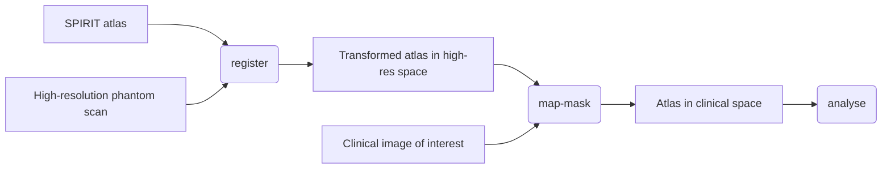

# Spirit Phantom library

Tools for analysing Gold Standard Phantoms (GSP) SPIRIT phantom data.

> [!NOTE]
> As with any QA tool, please validate results against your own reference before relying on them.

Typical use is a three-stage pipeline: register the SPIRIT atlas to a high-resolution phantom scan, transfer those labels onto a clinical image of interest, then analyse using the atlas in that image's space.



Skip the transfer step when the clinical image is the registration target: `register` already puts the atlas on that grid and you can analyse immediately (for example `analyse vial-measurements`). Use `analyse map-mask` when the scan of interest is a different grid, such as a multi-echo series. `analyse eg-thermometry` maps the ethylene glycol vials onto that series and estimates their temperature.

## What you can do

- Register a scanner image and measure vials — CLI (`register`, `analyse vial-measurements`)
- Transfer atlas labels onto another scan grid — CLI (`analyse map-mask`)
- Measure NEMA wedge slice thickness — CLI (`register --analyse slice-thickness`, `analyse slice-thickness`)
- Thermometry — ethylene glycol temperature from multi-echo GRE (`analyse eg-thermometry`)
- Developer QC helpers — CLI (`developer dice`, `developer vials`); see [Developer tools](docs/developer-tools.md)

## Installation

`spirit-phantom` supports Python 3.11–3.13. It is not published to a package index yet; install from GitHub with [uv](https://github.com/astral-sh/uv):

```bash
uv venv .venv --python=3.12
uv pip install 'git+https://github.com/gold-standard-phantoms/spirit-phantom'
```

## Command line

The CLI has three top-level groups:

- `register` — atlas-to-scanner registration
- `analyse` — product analyses (`vial-measurements`, `slice-thickness`, `map-mask`, `eg-thermometry`)
- `developer` — quality-control helpers (`dice`, `vials`); see [Developer tools](docs/developer-tools.md)

List commands and options:

```bash
uv run spirit-phantom --help
uv run spirit-phantom register --help
uv run spirit-phantom analyse --help
uv run spirit-phantom developer --help
```

Register the default SPIRIT atlas to a high-resolution scanner image, then measure vials and write checkerboard quality-control images:

```bash
uv run spirit-phantom register \
  path/to/scanner_image.nii.gz \
  --analyse vial-measurements \
  --generate-checkerboards
```

Run a standalone analysis on an already registered component atlas:

```bash
uv run spirit-phantom analyse vial-measurements \
  path/to/registration_output/transformed_component_atlas.nii.gz \
  path/to/scanner_image.nii.gz
```

Register and measure slice thickness from the two SPIRIT wedges in one step:

```bash
uv run spirit-phantom register \
  path/to/scanner_image.nii.gz \
  --output-directory path/to/registration_output \
  --analyse slice-thickness
```

Or measure it later from an existing registration:

```bash
uv run spirit-phantom analyse slice-thickness \
  path/to/registration_output \
  path/to/scanner_image.nii.gz
```

The terminal prints one thickness per wedge; QC files, profile plots,
`slice_thickness_summary.csv` and a diagnostic `slice_thickness.log` are
written to `path/to/registration_output/slice_thickness/`. See
[Slice thickness](#slice-thickness) below for how to read them.

Estimate ethylene glycol vial temperature from one or more multi-echo GRE series. Echo-time files are in seconds, one value per echo, one file per series:

```bash
uv run spirit-phantom analyse eg-thermometry \
  path/to/registration_output/transformed_component_atlas.nii.gz \
  path/to/gre_series_1.nii.gz \
  path/to/gre_series_2.nii.gz \
  --echo-times path/to/series_1_te_s.txt \
  --echo-times path/to/series_2_te_s.txt \
  --output-directory path/to/eg_thermometry
```

`--field-strength` defaults to 3 T. The command maps atlas labels 21 and 22 onto the first series, dilates them, and keeps voxels whose echo train has a large sum of absolute differences. qmri then fits the combined echo trains and writes the temperature map, a JSON report, and `temperature_measurements.txt`. `--vis` also saves the SAD mask plot and a signal-and-fit figure per vial.

Full command reference: [CLI usage](docs/cli.md).

## Documentation

Narrative guides are ordinary Markdown and can be read on GitHub:

- [CLI usage](docs/cli.md)
- [Python API usage](docs/python-api.md)
- [Interpreting outputs](docs/interpreting-outputs.md)
- [Example pulse sequences](docs/example-pulse-sequences.md)
- [Developer tools](docs/developer-tools.md)

### Slice Thickness

Slice thickness follows the wedge method of NEMA MS-5 2018. The analysis maps
the atlas wedge ROIs into scan space with an elastix-estimated inverse of the
registration transform. It then samples edge-response functions along each
wedge, differentiates them to give the slice profile, and multiplies the
profile's FWHM by tan α (α = 15° for SPIRIT).

Main outputs in `<registration_output>/slice_thickness/`:

- `slice_thickness_summary.csv` — one row per wedge: `thickness_mm`, the
  interpolated `fwhm_mm`, half-maximum crossings and sampling settings.
- `wedge_<label>_profiles.png` / `.csv` — edge-response functions and the slice
  profile with its half-maximum crossings. Expect one clean step and one
  well-defined peak.
- `slice_wedge_corners_fixed.nii.gz` — wedge corners in scan space; overlay on
  the scan to confirm they sit on the wedges.
- `slice_thickness.log` — diagnostics, including the inverse-transform
  round-trip residual.

Before trusting the number, check that:

- the two wedges agree;
- the projected FWHM spans at least six pixels (`fwhm_mm / pixel_size_mm` in
  the summary CSV), as NEMA requires;
- you allow for quantisation: `thickness_mm` uses half-maximum crossings
  rounded up to whole samples, so it moves in steps of
  `pixel_size_mm × tan α` (about 0.27 mm for 1 mm pixels).

The full guide, with an annotated example plot, is in
[Interpreting outputs](docs/interpreting-outputs.md#slice-thickness).

To compute thickness from your own edge-response data, call the NEMA function
directly. It expects a numpy array of shape `(n_samples, n_lines)` in which
each column is one edge response function (a line up the edge) with the signal
increasing along the axis. Multiple columns are averaged as separate edge
response functions.

```
from spirit_phantom.core import slice_thickness
spirit_slice_thickness = slice_thickness.nema_slice_thickness(
        volume_data_for_wedge_increasing_signal,
        pixel_size=pixel_size_mm,
    )
```

Calculation of slice thickness for the two wedges, checking for tilt along
the y-axis (NEMA MS-5 2018: Equation 6) and calculation of the mean is left
to the caller.

### Image Registration Function

The registration module provides functions for registering phantom images and
transforming point coordinates. Registration is performed using a multi-stage
approach: first a rigid (Euler) transform, then an affine transform, followed
by a B-spline transform.

To register a moving image to a fixed image:

```
from pathlib import Path
from spirit_phantom.core.registration import register_atlas

result = register_atlas(
    moving_image=Path("moving_image.nii.gz"),
    fixed_image=Path("fixed_image.nii.gz"),
    output_directory=Path("registration_output"),
    phantom_inverted=False,
)

# Access final registered image and transform (convenience aliases)
print(result.registered_image_path)       # Final registered image
print(result.registration_transform_path) # Final composed transform
print(result.transformed_component_atlas_path)  # Atlas components transformed to fixed-image space

# Access intermediate images
print(result.rigid_image_path)    # Rigid-registered image
print(result.affine_image_path)   # Affine-registered image
print(result.bspline_image_path)  # B-spline registered (same as registered_image_path)

# Access input parameters used for each stage
print(result.rigid_parameters_path)
print(result.affine_parameters_path)
print(result.bspline_parameters_path)

# Access output transforms for each stage
print(result.rigid_transform_path)
print(result.affine_transform_path)
print(result.bspline_transform_path)  # Same as registration_transform_path
```

The `register_atlas` function returns a `RegistrationResult` containing paths to all output files. All outputs are saved in the `output_directory`.

### Vial Statistics

The vial statistics module provides a method for extracting SPIRIT vial values
from a transformed component atlas and presenting a table of vial metadata and
measurement statistics.

```
from pathlib import Path

from spirit_phantom.core.vials import (
    compute_vial_statistics_details,
    print_vial_statistics_details_table,
    save_vial_statistics_details_table,
)

detailed_rows = compute_vial_statistics_details(
    registered_atlas_image_path=Path("transformed_component_atlas.nii.gz"),
    mri_scan_image_path=Path("scanner_image.nii.gz"),
    erosion_voxels=0,
)
print_vial_statistics_details_table(rows=detailed_rows)
save_vial_statistics_details_table(
    rows=detailed_rows,
    output_path=Path("vial_statistics_detailed.txt"),
)
```

Eroding vial ROIs is usually beneficial because it reduces edge artefacts and
registration boundary effects. The best value depends on your image resolution
and analysis goal, so choose `erosion_voxels` based on your data.


Vial measurement tables list all 22 configured vials (`A..V`), including thermometry vials `U` and `V`.

An example of the output is with no erosion:

| Vial ID | Product Code | Description           | Mean Intensity | Stdev     | Number of Voxels |
|---------|--------------|-----------------------|----------------|-----------|------------------|
| A       | MNCL-0320    | 0.320mM Aqueous MnCl2 | 383.614261     | 77.880100 | 71875            |
| B       | MNCL-0159    | 0.159mM Aqueous MnCl2 | 279.192702     | 57.907651 | 71748            |
| C       | MNCL-0110    | 0.110mM Aqueous MnCl2 | 192.972366     | 40.317790 | 72267            |
| D       | MNCL-0039    | 0.039mM Aqueous MnCl2 | 369.782298     | 63.996589 | 71290            |
| E       | PVP-0050     | 5% Aqueous PVP NiCl2  | 198.488653     | 42.202034 | 22738            |
| F       | PVP-0100     | 10% Aqueous PVP NiCl2 | 200.131383     | 37.887874 | 23009            |
| G       | PVP-0150     | 15% Aqueous PVP NiCl2 | 368.268869     | 61.760893 | 23160            |
| H       | PVP-0200     | 20% Aqueous PVP NiCl2 | 362.967385     | 64.678591 | 23149            |
| I       | PVP-0250     | 25% Aqueous PVP NiCl2 | 380.053787     | 66.807876 | 22812            |
| J       | PVP-0300     | 30% Aqueous PVP NiCl2 | 371.809641     | 66.445551 | 22799            |
| K       | PVP-0400     | 40% Aqueous PVP NiCl2 | 277.656956     | 47.257150 | 22621            |
| L       | PVP-0500     | 50% Aqueous PVP       | 282.064033     | 51.086179 | 22879            |
| M       | MNCL-0078    | 0.078mM Aqueous MnCl2 | 341.567342     | 67.871481 | 24123            |
| N       | MNCL-0110    | 0.110mM Aqueous MnCl2 | 308.490297     | 59.404350 | 23447            |
| O       | MNCL-0480    | 0.480mM Aqueous MnCl2 | 397.452877     | 77.854880 | 23916            |
| P       | MNCL-0039    | 0.039mM Aqueous MnCl2 | 195.410605     | 34.654564 | 22669            |
| Q       | MNCL-0630    | 0.630mM Aqueous MnCl2 | 274.209387     | 51.286216 | 22456            |
| R       | MNCL-0320    | 0.320mM Aqueous MnCl2 | 341.248839     | 57.818041 | 22826            |
| S       | MNCL-0017    | 0.017mM Aqueous MnCl2 | 238.341952     | 45.232980 | 23012            |
| T       | MNCL-0159    | 0.159mM Aqueous MnCl2 | 359.478665     | 73.337451 | 23881            |

An example of the output is with `erosion_voxels=1`:

| Vial ID | Product Code | Description           | Mean Intensity | Stdev     | Number of Voxels |
|---------|--------------|-----------------------|----------------|-----------|------------------|
| A       | MNCL-0320    | 0.320mM Aqueous MnCl2 | 407.986083     | 13.173449 | 42251            |
| B       | MNCL-0159    | 0.159mM Aqueous MnCl2 | 297.407621     | 10.259056 | 42044            |
| C       | MNCL-0110    | 0.110mM Aqueous MnCl2 | 205.565967     | 9.084624  | 42347            |
| D       | MNCL-0039    | 0.039mM Aqueous MnCl2 | 388.539982     | 11.497023 | 42031            |
| E       | PVP-0050     | 5% Aqueous PVP NiCl2  | 204.181276     | 22.335345 | 11579            |
| F       | PVP-0100     | 10% Aqueous PVP NiCl2 | 204.625617     | 22.757468 | 11758            |
| G       | PVP-0150     | 15% Aqueous PVP NiCl2 | 376.756788     | 37.117770 | 11969            |
| H       | PVP-0200     | 20% Aqueous PVP NiCl2 | 372.564816     | 36.220253 | 11926            |
| I       | PVP-0250     | 25% Aqueous PVP NiCl2 | 388.671666     | 40.846955 | 11668            |
| J       | PVP-0300     | 30% Aqueous PVP NiCl2 | 381.078283     | 40.157710 | 11599            |
| K       | PVP-0400     | 40% Aqueous PVP NiCl2 | 281.891059     | 31.866884 | 11520            |
| L       | PVP-0500     | 50% Aqueous PVP       | 289.681632     | 27.082627 | 11738            |
| M       | MNCL-0078    | 0.078mM Aqueous MnCl2 | 355.301416     | 28.396466 | 12574            |
| N       | MNCL-0110    | 0.110mM Aqueous MnCl2 | 319.399306     | 32.319146 | 12096            |
| O       | MNCL-0480    | 0.480mM Aqueous MnCl2 | 413.484241     | 36.169857 | 12469            |
| P       | MNCL-0039    | 0.039mM Aqueous MnCl2 | 200.654553     | 18.833725 | 11530            |
| Q       | MNCL-0630    | 0.630mM Aqueous MnCl2 | 281.663908     | 28.163795 | 11360            |
| R       | MNCL-0320    | 0.320mM Aqueous MnCl2 | 351.518779     | 23.100912 | 11662            |
| S       | MNCL-0017    | 0.017mM Aqueous MnCl2 | 244.778041     | 22.960382 | 11804            |
| T       | MNCL-0159    | 0.159mM Aqueous MnCl2 | 373.729220     | 31.781529 | 12464            |

### Checkerboard visualisation

After registration, checkerboard images can be generated to visually inspect the
alignment between the fixed and registered images on selected axial slices.
How to read them: [Interpreting outputs](docs/interpreting-outputs.md).

```
from pathlib import Path

from spirit_phantom.utils.visualisation import visualise_checkerboard

checkerboard_paths = visualise_checkerboard(
    fixed_image_path=Path("fixed_image.nii.gz"),
    registered_image_path=Path("registration_output/registered_image.nii.gz"),
    slice_indices=[180, 240, 300],
    save_directory=Path("registration_output/checkerboards"),
)

for checkerboard_path in checkerboard_paths:
    print(checkerboard_path)
```

The `slice_indices` argument specifies the axial slice indices (z indices) at which
checkerboard images are generated, allowing visual assessment of registration
quality on slices of interest.

`visualise_checkerboard` returns a list of output PNG paths. Each image is saved
in `save_directory`, or in the directory containing `registered_image_path` when
no save directory is provided.

## Development

From a clone:

```bash
uv sync
uv run pytest
uv run mkdocs serve
```

Then open [http://127.0.0.1:8000/](http://127.0.0.1:8000/). `uv sync` is required because MkDocs is a development dependency; `uv pip install` from git does not include it.

Hosted documentation: [https://gold-standard-phantoms.github.io/spirit-phantom/](https://gold-standard-phantoms.github.io/spirit-phantom/) (public). On the office network or VPN, with a GSP sign-in: [http://docs.internal/spirit-phantom/](http://docs.internal/spirit-phantom/).

See [Developer tools](docs/developer-tools.md) for linting, type checking, Dice scoring (`developer dice`), and QC helpers.
