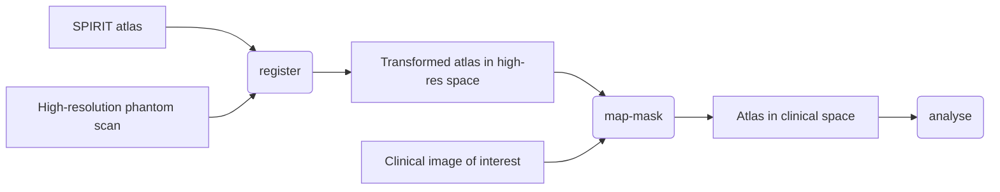

# Spirit Phantom library

Tools for analysing Gold Standard Phantoms (GSP) SPIRIT phantom data.

Typical use is a three-stage pipeline: register the SPIRIT atlas to a high-resolution phantom scan, transfer those labels onto a clinical image of interest, then analyse using the atlas in that image's space.



Skip the transfer step when the clinical image is the registration target: `register` already puts the atlas on that grid and you can analyse immediately (for example `analyse vial-measurements`). Use `analyse map-mask` when the scan of interest is a different grid, such as a multi-echo series. `analyse eg-mask` remains the thermometry precursor (ethylene glycol mask only; no temperature yet).

## What you can do

- Register a scanner image and measure vials — CLI (`register`, `analyse vial-measurements`)
- Transfer atlas labels onto another scan grid — CLI (`analyse map-mask`)
- NEMA slice thickness — Python API only (no CLI yet)
- Thermometry — in development (ethylene glycol mask helpers exist; no temperature analysis yet)
- Developer QC helpers — CLI (`developer dice`, `developer vials`); see [Developer tools](docs/developer-tools.md)

## Installation

`spirit-phantom` supports Python 3.11–3.13. It is not published to a package index yet; install from GitHub with [uv](https://github.com/astral-sh/uv):

```bash
uv venv .venv --python=3.12
uv pip install 'git+https://github.com/gold-standard-phantoms/spirit-phantom'
```

## Command line

The CLI has three top-level groups:

- `register` — atlas-to-scanner registration
- `analyse` — product analyses (`vial-measurements`, `map-mask`, `eg-mask`)
- `developer` — quality-control helpers (`dice`, `vials`); see [Developer tools](docs/developer-tools.md)

List commands and options:

```bash
uv run spirit-phantom --help
uv run spirit-phantom register --help
uv run spirit-phantom analyse --help
uv run spirit-phantom developer --help
```

Register the default SPIRIT atlas to a high-resolution scanner image, then measure vials and write checkerboard quality-control images:

```bash
uv run spirit-phantom register \
  path/to/scanner_image.nii.gz \
  --analyse vial-measurements \
  --generate-checkerboards
```

Run a standalone analysis on an already registered component atlas:

```bash
uv run spirit-phantom analyse vial-measurements \
  path/to/registration_output/transformed_component_atlas.nii.gz \
  path/to/scanner_image.nii.gz
```

Atomic ethylene glycol mask generation (single-slice multi-echo GRE):

```bash
uv run spirit-phantom analyse eg-mask \
  path/to/registered_component_atlas.nii.gz \
  path/to/multiecho_scan.nii.gz \
  --output-mask-image-path path/to/output_mask.nii.gz \
  --minimum-sad-counts 1000 \
  --dilation-iterations 1 \
  --vis
```

If `--output-mask-image-path` is omitted, the output defaults to:

`<parent of multiecho_scan>/ethylene_glycol_mask_<timestamp>.nii.gz`

The `eg-mask` workflow:

- Applies binary dilation to the mapped EG segmentation before filtering.
- Computes `sum(abs(S[n] - S[n-1]))` across the 4th dimension for each candidate voxel.
- Rejects voxels with summed absolute difference below the configured threshold.
- Saves a diagnostic plot next to the mask as `<mask_stem>_sad_filter_plot.png` when `--vis` is enabled.

Full command reference: [CLI usage](docs/cli.md).

## Documentation

Narrative guides are ordinary Markdown and can be read on GitHub:

- [CLI usage](docs/cli.md)
- [Python API usage](docs/python-api.md)
- [Developer tools](docs/developer-tools.md)

### Slice Thickness

The NEMA MS-5 2018 slice thickness function will be used as an example. 
The spirit-phantom function expects a numpy array for the wedge ROI ordered 
such that the rows each contain one edge transfer function (line up the edge)
with the signal increasing in the direction of the axis. 
An array with multiple rows will be used to input more than one edge transfer 
function.

```
from spirit_phantom.core import slice_thickness
spirit_slice_thickness = slice_thickness.nema_slice_thickness(
        volume_data_for_wedge_increasing_signal,
        pixel_size=pixel_size_mm,
    )
```

Calculation of slice thickness for the two wedges, checking for tilt along
the y-axis (NEMA MS-5 2018: Equation 6) and calculation of the mean is left
to the caller.

### Image Registration Function

The registration module provides functions for registering phantom images and
transforming point coordinates. Registration is performed using a multi-stage
approach: first a rigid (Euler) transform, then an affine transform, followed
by a B-spline transform.

To register a moving image to a fixed image:

```
from pathlib import Path
from spirit_phantom.core.registration import register_atlas

result = register_atlas(
    moving_image=Path("moving_image.nii.gz"),
    fixed_image=Path("fixed_image.nii.gz"),
    output_directory=Path("registration_output"),
    phantom_inverted=False,
)

# Access final registered image and transform (convenience aliases)
print(result.registered_image_path)       # Final registered image
print(result.registration_transform_path) # Final composed transform
print(result.transformed_component_atlas_path)  # Atlas components transformed to fixed-image space

# Access intermediate images
print(result.rigid_image_path)    # Rigid-registered image
print(result.affine_image_path)   # Affine-registered image
print(result.bspline_image_path)  # B-spline registered (same as registered_image_path)

# Access input parameters used for each stage
print(result.rigid_parameters_path)
print(result.affine_parameters_path)
print(result.bspline_parameters_path)

# Access output transforms for each stage
print(result.rigid_transform_path)
print(result.affine_transform_path)
print(result.bspline_transform_path)  # Same as registration_transform_path
```

The `register_atlas` function returns a `RegistrationResult` containing paths to all output files. All outputs are saved in the `output_directory`.

### Vial Statistics

The vial statistics module provides a method for extracting SPIRIT vial values
from a transformed component atlas and presenting a table of vial metadata and
measurement statistics.

```
from pathlib import Path

from spirit_phantom.core.vials import (
    compute_vial_statistics_details,
    print_vial_statistics_details_table,
    save_vial_statistics_details_table,
)

detailed_rows = compute_vial_statistics_details(
    registered_atlas_image_path=Path("transformed_component_atlas.nii.gz"),
    mri_scan_image_path=Path("scanner_image.nii.gz"),
    erosion_voxels=0,
)
print_vial_statistics_details_table(rows=detailed_rows)
save_vial_statistics_details_table(
    rows=detailed_rows,
    output_path=Path("vial_statistics_detailed.txt"),
)
```

Eroding vial ROIs is usually beneficial because it reduces edge artefacts and
registration boundary effects. The best value depends on your image resolution
and analysis goal, so choose `erosion_voxels` based on your data.


Vial measurement tables list all 22 configured vials (`A..V`), including thermometry vials `U` and `V`.

An example of the output is with no erosion:

| Vial ID | Product Code | Description           | Mean Intensity | Stdev     | Number of Voxels |
|---------|--------------|-----------------------|----------------|-----------|------------------|
| A       | MNCL-0320    | 0.320mM Aqueous MnCl2 | 383.614261     | 77.880100 | 71875            |
| B       | MNCL-0159    | 0.159mM Aqueous MnCl2 | 279.192702     | 57.907651 | 71748            |
| C       | MNCL-0110    | 0.110mM Aqueous MnCl2 | 192.972366     | 40.317790 | 72267            |
| D       | MNCL-0039    | 0.039mM Aqueous MnCl2 | 369.782298     | 63.996589 | 71290            |
| E       | PVP-0050     | 5% Aqueous PVP NiCl2  | 198.488653     | 42.202034 | 22738            |
| F       | PVP-0100     | 10% Aqueous PVP NiCl2 | 200.131383     | 37.887874 | 23009            |
| G       | PVP-0150     | 15% Aqueous PVP NiCl2 | 368.268869     | 61.760893 | 23160            |
| H       | PVP-0200     | 20% Aqueous PVP NiCl2 | 362.967385     | 64.678591 | 23149            |
| I       | PVP-0250     | 25% Aqueous PVP NiCl2 | 380.053787     | 66.807876 | 22812            |
| J       | PVP-0300     | 30% Aqueous PVP NiCl2 | 371.809641     | 66.445551 | 22799            |
| K       | PVP-0400     | 40% Aqueous PVP NiCl2 | 277.656956     | 47.257150 | 22621            |
| L       | PVP-0500     | 50% Aqueous PVP       | 282.064033     | 51.086179 | 22879            |
| M       | MNCL-0078    | 0.078mM Aqueous MnCl2 | 341.567342     | 67.871481 | 24123            |
| N       | MNCL-0110    | 0.110mM Aqueous MnCl2 | 308.490297     | 59.404350 | 23447            |
| O       | MNCL-0480    | 0.480mM Aqueous MnCl2 | 397.452877     | 77.854880 | 23916            |
| P       | MNCL-0039    | 0.039mM Aqueous MnCl2 | 195.410605     | 34.654564 | 22669            |
| Q       | MNCL-0630    | 0.630mM Aqueous MnCl2 | 274.209387     | 51.286216 | 22456            |
| R       | MNCL-0320    | 0.320mM Aqueous MnCl2 | 341.248839     | 57.818041 | 22826            |
| S       | MNCL-0017    | 0.017mM Aqueous MnCl2 | 238.341952     | 45.232980 | 23012            |
| T       | MNCL-0159    | 0.159mM Aqueous MnCl2 | 359.478665     | 73.337451 | 23881            |

An example of the output is with `erosion_voxels=1`:

| Vial ID | Product Code | Description           | Mean Intensity | Stdev     | Number of Voxels |
|---------|--------------|-----------------------|----------------|-----------|------------------|
| A       | MNCL-0320    | 0.320mM Aqueous MnCl2 | 407.986083     | 13.173449 | 42251            |
| B       | MNCL-0159    | 0.159mM Aqueous MnCl2 | 297.407621     | 10.259056 | 42044            |
| C       | MNCL-0110    | 0.110mM Aqueous MnCl2 | 205.565967     | 9.084624  | 42347            |
| D       | MNCL-0039    | 0.039mM Aqueous MnCl2 | 388.539982     | 11.497023 | 42031            |
| E       | PVP-0050     | 5% Aqueous PVP NiCl2  | 204.181276     | 22.335345 | 11579            |
| F       | PVP-0100     | 10% Aqueous PVP NiCl2 | 204.625617     | 22.757468 | 11758            |
| G       | PVP-0150     | 15% Aqueous PVP NiCl2 | 376.756788     | 37.117770 | 11969            |
| H       | PVP-0200     | 20% Aqueous PVP NiCl2 | 372.564816     | 36.220253 | 11926            |
| I       | PVP-0250     | 25% Aqueous PVP NiCl2 | 388.671666     | 40.846955 | 11668            |
| J       | PVP-0300     | 30% Aqueous PVP NiCl2 | 381.078283     | 40.157710 | 11599            |
| K       | PVP-0400     | 40% Aqueous PVP NiCl2 | 281.891059     | 31.866884 | 11520            |
| L       | PVP-0500     | 50% Aqueous PVP       | 289.681632     | 27.082627 | 11738            |
| M       | MNCL-0078    | 0.078mM Aqueous MnCl2 | 355.301416     | 28.396466 | 12574            |
| N       | MNCL-0110    | 0.110mM Aqueous MnCl2 | 319.399306     | 32.319146 | 12096            |
| O       | MNCL-0480    | 0.480mM Aqueous MnCl2 | 413.484241     | 36.169857 | 12469            |
| P       | MNCL-0039    | 0.039mM Aqueous MnCl2 | 200.654553     | 18.833725 | 11530            |
| Q       | MNCL-0630    | 0.630mM Aqueous MnCl2 | 281.663908     | 28.163795 | 11360            |
| R       | MNCL-0320    | 0.320mM Aqueous MnCl2 | 351.518779     | 23.100912 | 11662            |
| S       | MNCL-0017    | 0.017mM Aqueous MnCl2 | 244.778041     | 22.960382 | 11804            |
| T       | MNCL-0159    | 0.159mM Aqueous MnCl2 | 373.729220     | 31.781529 | 12464            |

### Checkerboard visualisation

After registration, checkerboard images can be generated to visually inspect the
alignment between the fixed and registered images on selected axial slices:

```
from pathlib import Path

from spirit_phantom.utils.visualisation import visualise_checkerboard

checkerboard_paths = visualise_checkerboard(
    fixed_image_path=Path("fixed_image.nii.gz"),
    registered_image_path=Path("registration_output/registered_image.nii.gz"),
    slice_indices=[180, 240, 300],
    save_directory=Path("registration_output/checkerboards"),
)

for checkerboard_path in checkerboard_paths:
    print(checkerboard_path)
```

The `slice_indices` argument specifies the axial slice indices (z indices) at which
checkerboard images are generated, allowing visual assessment of registration
quality on slices of interest.

`visualise_checkerboard` returns a list of output PNG paths. Each image is saved
in `save_directory`, or in the directory containing `registered_image_path` when
no save directory is provided.

## Development

From a clone:

```bash
uv sync
uv run pytest
uv run mkdocs serve
```

Then open [http://127.0.0.1:8000/](http://127.0.0.1:8000/). `uv sync` is required because MkDocs is a development dependency; `uv pip install` from git does not include it.

Hosted documentation (after GitHub Pages is enabled): [https://gold-standard-phantoms.github.io/spirit-phantom/](https://gold-standard-phantoms.github.io/spirit-phantom/)

See [Developer tools](docs/developer-tools.md) for linting, type checking, Dice scoring (`developer dice`), and QC helpers.
