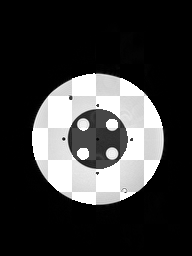
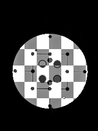
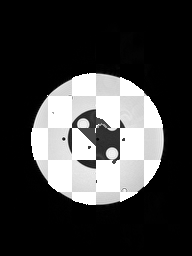

# Interpreting outputs

How to read common quality-control and analysis products from this package. This page will grow as more outputs are documented. It currently covers registration checkerboard images, slice-thickness results, scanner-distortion residuals, and ethylene glycol thermometry.

## Checkerboard images

After registration, `--generate-checkerboards` writes PNG overlays that compare the registered atlas with the MRI on selected axial slices. The overlay is a [checkerboard pattern](https://examples.itk.org/src/filtering/imagecompare/combinetwoimageswithcheckerboardpattern/documentation): the image is divided into a grid of tiles that alternate between the registered atlas and the scanner image.

Where atlas structures line up with the corresponding MRI structures across tile boundaries, orientation and alignment are good. Breaks, steps, or offsets at those boundaries indicate misregistration.

### Pay attention to the slice wedges

The slice-thickness wedges are especially useful for spotting small translational or rotational errors. Check that their edges continue smoothly from atlas tiles into MRI tiles.

### Good registration

In a successful registration, phantom outlines, vials, and wedges remain continuous across tile edges even though intensity and texture change from tile to tile.

|  |  |  |
| --- | --- | --- |

### Poor registration

When registration fails, the same structures do not meet at tile boundaries: circles look stepped, vial walls jump, and slice wedges are offset between atlas and MRI tiles.

|  |  |  |
| --- | --- | --- |

Registration performed with the phantom and atlas inverted with respect to one another.

Generate these overlays from the CLI with `--generate-checkerboards`, or from Python with `visualise_checkerboard` (see [CLI usage](cli.md) and [Python API usage](python-api.md)).

## Slice thickness

`register --analyse slice-thickness` and `analyse slice-thickness` measure slice thickness with the wedge method of [NEMA MS 5-2018](https://www.nema.org/Standards/view/Determination-of-Slice-Thickness-in-Diagnostic-Magnetic-Resonance-Imaging) (Section 2.2). The SPIRIT phantom has two wedges inclined at α = 15° to the slice plane. For each wedge the analysis:

1. Maps the wedge ROI corners from the atlas into scan space with an elastix-estimated inverse of the registration transform.
2. Samples edge-response functions (ERFs) along the wedge's long axis on several parallel lines.
3. Differentiates each ERF to give the projected slice profile and averages the lines.
4. Measures the full width at half maximum (FWHM) of the mean profile and multiplies it by tan α to give the slice thickness.

### Terminal summary

```text
wedge_label | thickness_mm | pixel_size_mm | n_lines | n_samples
1 | 1.3377 | 0.9984 | 3 | 51
2 | 1.3381 | 0.9988 | 3 | 51
```

| Column | Meaning |
| --- | --- |
| `wedge_label` | Wedge 1 or 2. |
| `thickness_mm` | NEMA slice thickness in millimetres. |
| `pixel_size_mm` | Sample spacing along the wedge's long axis (close to the in-plane voxel size). |
| `n_lines` | Profile lines averaged, after `--discard-edge-lines` removes lines from each side. |
| `n_samples` | Samples along each line. |

### Output files

Files are written to the slice-thickness output directory (by default `<registration_output>/slice_thickness/`).

| File | Use it to |
| --- | --- |
| `slice_thickness_summary.csv` | Record the result: one row per wedge with thickness, FWHM, half-maximum crossings and sampling settings. |
| `wedge_<label>_profiles.png` | Check the measurement visually (see below). |
| `wedge_<label>_profiles.csv` | Re-plot or re-analyse the per-line and mean ERFs and slice profiles. |
| `slice_wedge_corners_fixed.nii.gz` | Overlay on the scan to confirm the wedge corners landed on the wedges. |
| `slice_wedge_mask_atlas.nii.gz`, `slice_wedge_corners_atlas.nii.gz` | The same ROIs and corners in atlas space, for comparison. |
| `wedge_corners_fixed_mm.txt` | Scan-space corner coordinates in millimetres, in processing order. |
| `slice_thickness.log` | Diagnostics: inverse-transform round-trip residual, half-maximum crossings and slice profiles. |
| `moving_to_fixed/` | Inverse transform and transformix point files used to map the corners. |

### Reading the profile plot


The top panel shows the ERFs: grey curves for individual lines, blue for their mean. A good measurement shows a single clean step from low to high signal where the slice crosses the wedge. The bottom panel shows the slice profile (the derivative of the ERF). Its peak should be single and well defined. The dashed red line marks half of the peak, and the dotted green lines mark where the mean profile crosses it.

Warning signs:

- **No clear step, or a step at the very start or end of the profile.** The ROI probably missed the wedge. Check `slice_wedge_corners_fixed.nii.gz` on the scan and the registration [checkerboard images](#checkerboard-images).
- **Several peaks, or a peak that barely rises above the noise.** The ROI may overlap another structure, or the signal-to-noise ratio is too low. NEMA requires a slice-profile SNR above 10.
- **Grey per-line curves that disagree strongly with each other.** The outer lines may be affected by partial volume at the wedge edges. Increase `--discard-edge-lines`.

### Checks before trusting the number

- **Both wedges should agree.** A large difference between wedges suggests the slice is tilted relative to the phantom. The NEMA rotational correction (Section 4) is not applied, so report both values and investigate the difference.
- **Enough samples across the profile.** NEMA requires at least six pixels across the projected FWHM. Check `fwhm_mm / pixel_size_mm` in the summary CSV. With a 15° wedge the projected FWHM is about 3.7 times the slice thickness, so slices thinner than about 1.6 × the in-plane pixel size fall below this requirement. In the example above, 5.19 / 0.998 ≈ 5.2 pixels, which is below.
- **The reported thickness is quantised.** `thickness_mm` follows the NEMA procedure as implemented in `nema_slice_thickness`: the half-maximum crossings are rounded up to whole samples. The result therefore moves in steps of `pixel_size_mm × tan α`, about 0.27 mm for 1 mm pixels. `fwhm_mm` in the CSVs uses interpolated crossings, so `fwhm_mm × tan α` gives an unrounded estimate for comparison (1.39 mm for wedge 1 in the example, against the reported 1.34 mm).
- **The corner mapping should be accurate.** `slice_thickness.log` records the inverse-transform round-trip residual, which should be well below a voxel. A warning is printed if it exceeds 0.1 mm.

## Scanner distortion

`register --analyse distortion` and `analyse distortion` estimate scanner
geometric distortion at the 34 SPIRIT fiducials by reporting the displacement
induced by the affine and B-spline registration stages after excluding rigid
pose. The full method and open doubts are in
[Scanner distortion](scanner-distortion.md).

### Terminal summary

```text
n_fiducials | mean_magnitude_mm | max_magnitude_mm | rms_magnitude_mm | max_nonrigid_roundtrip_residual_mm
34 | 0.4120 | 1.2030 | 0.5010 | 0.0120
```

| Column | Meaning |
| --- | --- |
| `n_fiducials` | Number of packaged landmarks evaluated (34). |
| `mean_magnitude_mm` | Mean \(\|p_m - p_r\|\) over fiducials. |
| `max_magnitude_mm` | Largest per-fiducial magnitude. |
| `rms_magnitude_mm` | Root-mean-square magnitude. |
| `max_nonrigid_roundtrip_residual_mm` | Worst absolute residual of affine+B-spline applied to post-rigid points versus `atlas_mm`. Should be ≪ 1 mm. |

### Output files

Files are written to the distortion output directory (by default
`<registration_output>/distortion/`).

| File | Use it to |
| --- | --- |
| `distortion_summary.csv` | Record the aggregate magnitudes above. |
| `distortion_per_point.csv` | Plot magnitude versus radius from isocentre, or inspect per-axis components. |
| `fiducials_fixed_mm.nii.gz` | Overlay on the scan: markers should sit on the dark fiducial spheres. |
| `fiducials_*.txt` | Re-run transformix or external plotting from the stage-wise point dumps. |
| `affine_bspline_only/` | Inspect the rewritten transform chain with rigid unlinked. |
| `distortion.log` | Diagnostics for inverse and non-rigid round-trip residuals. |

### Checks before trusting the numbers

- **Fixed-space markers land on the spheres.** If `fiducials_fixed_mm.nii.gz`
  misses the voids, the registration (or its inverse) is wrong and the residual
  is not scanner distortion.
- **Non-rigid round-trip is tiny.** A large
  `max_nonrigid_roundtrip_residual_mm` means the rewritten affine+B-spline chain
  does not compose cleanly with the rigid stage; do not trust the table.
- **Magnitude should trend with radius.** Classic gradient non-linearity grows
  away from isocentre. A flat or noisy radius plot suggests residual pose error
  or registration noise rather than a physical field.
- **Headers look sane.** Voxel size / matrix differences are handled by image
  geometry, not by the rigid stage; wrong spacing still biases the residual.
  See [Scanner distortion](scanner-distortion.md#what-rigid-excludes-and-what-it-does-not).
- **Read the open doubts.** Remaining method caveats are listed under
  [Scanner distortion](scanner-distortion.md#open-doubts).

## Ethylene glycol thermometry

`analyse eg-thermometry` estimates the temperature of the ethylene glycol NMR vials, U and V (atlas labels 21 and 22), from one or more multi-echo GRE series. The command maps those labels onto the first series, keeps voxels whose echo train has a large sum of absolute differences, and fits the combined echoes with qmri. Field strength defaults to 3 T.

### Terminal summary

For example:

```text
Ethylene glycol thermometry
Magnetic field: 3 T
Method: regionwise
Uncertainties are standard uncertainties (k=1).

vial    segment   temperature_C   uncertainty_C       df_Hz   r_squared  n_voxels
U            21           14.20            0.28       224.3       0.980        55
V            22           14.85            0.21       223.5       0.986        54
```

The same table is written to `temperature_measurements.txt`.

| Column | Meaning |
| --- | --- |
| `vial` | Vial letter. U and V are the ethylene glycol vials. |
| `segment` | Atlas label fitted for that vial (21 and 22). |
| `temperature_C` | Representative vial temperature in degrees Celsius. |
| `uncertainty_C` | Standard uncertainty of that temperature, coverage factor k=1. |
| `df_Hz` | Fitted frequency difference between the ethylene glycol resonances, in hertz. |
| `r_squared` | Mean coefficient of determination of the fits for that vial. |
| `n_voxels` | Voxels in the vial after the mask filter. |

`regionwise` fits the mean signal of each vial, so the table is one temperature per vial. `voxelwise` and `regionwise_bootstrap` still report one representative temperature per vial; the per-fit values stay in the qmri JSON report.

### Output files

Files are written to the thermometry output directory (by default `eg_thermometry` beside the first GRE image).

| File | Use it to |
| --- | --- |
| `temperature_measurements.txt` | Record the vial temperatures shown in the terminal. |
| `eg_thermometry_temperature_map.nii.gz` | Read the qmri temperature map, in degrees Celsius, on the first series' grid. |
| `eg_thermometry_report.json` | Inspect the qmri fit: echo times, parameters, per-fit temperatures and uncertainties. |
| `ethylene_glycol_mask.nii.gz` | Check which voxels were labelled 21 and 22 and kept by the SAD filter. |
| `ethylene_glycol_mask_sad_filter_plot.png` | See which echo trains the mask kept. Written with `--vis`. |
| `vial_U_signal_fit.png`, `vial_V_signal_fit.png` | Compare the measured echoes with the fitted dual-resonance curve. Written with `--vis`. |

### Reading the signal-fit plot

`--vis` writes one figure per vial. The upper panel plots signal against echo time in milliseconds. Each GRE series uses its own marker, and the curve is the dual-resonance model fitted to those samples. The lower panel is the residual of the mean signal minus that curve. A useful fit follows the beat pattern of the echoes, and the residual is small compared with the signal. The title reports the vial temperature and the mean R².

### Reading the SAD filter plot

`--vis` also writes `ethylene_glycol_mask_sad_filter_plot.png`. Green traces are echo trains kept in the mask. Red traces are trains rejected because their sum of absolute differences is below the threshold printed on the figure. If a vial that should be present is missing from the temperature table, this plot shows whether the filter removed it. Lower `--minimum-sad-counts` to keep more voxels, or raise it when background is leaking into the mask.
