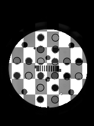
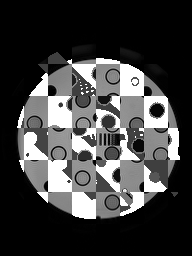
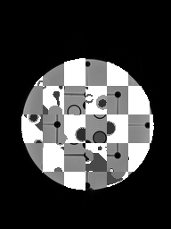
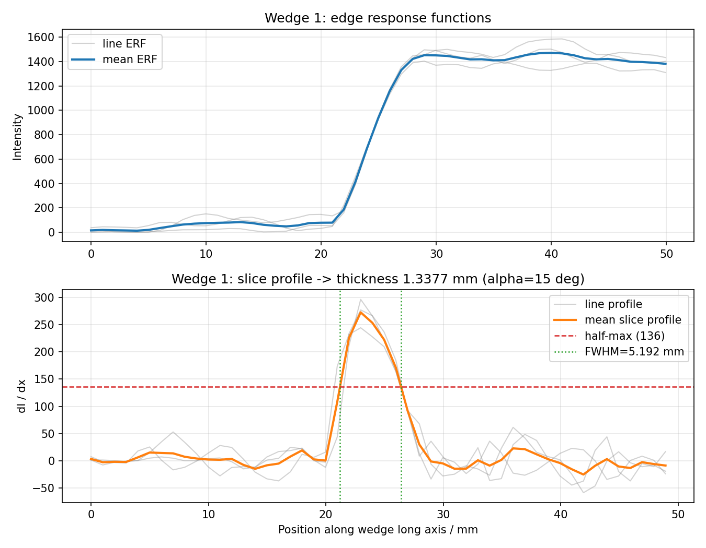

# Interpreting outputs

How to read common quality-control and analysis products from this package. This page will grow as more outputs are documented. It currently covers registration checkerboard images and slice-thickness results.

## Checkerboard images

After registration, `--generate-checkerboards` writes PNG overlays that compare the registered atlas with the MRI on selected axial slices. The overlay is a [checkerboard pattern](https://examples.itk.org/src/filtering/imagecompare/combinetwoimageswithcheckerboardpattern/documentation): the image is divided into a grid of tiles that alternate between the registered atlas and the scanner image.

Where atlas structures line up with the corresponding MRI structures across tile boundaries, orientation and alignment are good. Breaks, steps, or offsets at those boundaries indicate misregistration.

### Pay attention to the slice wedges

The slice-thickness wedges are especially useful for spotting small translational or rotational errors. Check that their edges continue smoothly from atlas tiles into MRI tiles.

### Good registration

In a successful registration, phantom outlines, vials, and wedges remain continuous across tile edges even though intensity and texture change from tile to tile.

|  |  |  |
| --- | --- | --- |

### Poor registration

When registration fails, the same structures do not meet at tile boundaries: circles look stepped, vial walls jump, and slice wedges are offset between atlas and MRI tiles.

|  |  |  |
| --- | --- | --- |

Registration performed with the phantom and atlas inverted with respect to one another.

Generate these overlays from the CLI with `--generate-checkerboards`, or from Python with `visualise_checkerboard` (see [CLI usage](cli.md) and [Python API usage](python-api.md)).

## Slice thickness

`register --analyse slice-thickness` and `analyse slice-thickness` measure slice thickness with the wedge method of [NEMA MS 5-2018](https://www.nema.org/Standards/view/Determination-of-Slice-Thickness-in-Diagnostic-Magnetic-Resonance-Imaging) (Section 2.2). The SPIRIT phantom has two wedges inclined at α = 15° to the slice plane. For each wedge the analysis:

1. Maps the wedge ROI corners from the atlas into scan space with an elastix-estimated inverse of the registration transform.
2. Samples edge-response functions (ERFs) along the wedge's long axis on several parallel lines.
3. Differentiates each ERF to give the projected slice profile and averages the lines.
4. Measures the full width at half maximum (FWHM) of the mean profile and multiplies it by tan α to give the slice thickness.

### Terminal summary

```text
wedge_label | thickness_mm | pixel_size_mm | n_lines | n_samples
1 | 1.3377 | 0.9984 | 3 | 51
2 | 1.3381 | 0.9988 | 3 | 51
```

| Column | Meaning |
| --- | --- |
| `wedge_label` | Wedge 1 or 2. |
| `thickness_mm` | NEMA slice thickness in millimetres. |
| `pixel_size_mm` | Sample spacing along the wedge's long axis (close to the in-plane voxel size). |
| `n_lines` | Profile lines averaged, after `--discard-edge-lines` removes lines from each side. |
| `n_samples` | Samples along each line. |

### Output files

Files are written to the slice-thickness output directory (by default `<registration_output>/slice_thickness/`).

| File | Use it to |
| --- | --- |
| `slice_thickness_summary.csv` | Record the result: one row per wedge with thickness, FWHM, half-maximum crossings and sampling settings. |
| `wedge_<label>_profiles.png` | Check the measurement visually (see below). |
| `wedge_<label>_profiles.csv` | Re-plot or re-analyse the per-line and mean ERFs and slice profiles. |
| `slice_wedge_corners_fixed.nii.gz` | Overlay on the scan to confirm the wedge corners landed on the wedges. |
| `slice_wedge_mask_atlas.nii.gz`, `slice_wedge_corners_atlas.nii.gz` | The same ROIs and corners in atlas space, for comparison. |
| `wedge_corners_fixed_mm.txt` | Scan-space corner coordinates in millimetres, in processing order. |
| `slice_thickness.log` | Diagnostics: inverse-transform round-trip residual, half-maximum crossings and slice profiles. |
| `moving_to_fixed/` | Inverse transform and transformix point files used to map the corners. |

### Reading the profile plot



The top panel shows the ERFs: grey curves for individual lines, blue for their mean. A good measurement shows a single clean step from low to high signal where the slice crosses the wedge. The bottom panel shows the slice profile (the derivative of the ERF). Its peak should be single and well defined. The dashed red line marks half of the peak, and the dotted green lines mark where the mean profile crosses it.

Warning signs:

- **No clear step, or a step at the very start or end of the profile.** The ROI probably missed the wedge. Check `slice_wedge_corners_fixed.nii.gz` on the scan and the registration [checkerboard images](#checkerboard-images).
- **Several peaks, or a peak that barely rises above the noise.** The ROI may overlap another structure, or the signal-to-noise ratio is too low. NEMA requires a slice-profile SNR above 10.
- **Grey per-line curves that disagree strongly with each other.** The outer lines may be affected by partial volume at the wedge edges. Increase `--discard-edge-lines`.

### Checks before trusting the number

- **Both wedges should agree.** A large difference between wedges suggests the slice is tilted relative to the phantom. The NEMA rotational correction (Section 4) is not applied, so report both values and investigate the difference.
- **Enough samples across the profile.** NEMA requires at least six pixels across the projected FWHM. Check `fwhm_mm / pixel_size_mm` in the summary CSV. With a 15° wedge the projected FWHM is about 3.7 times the slice thickness, so slices thinner than about 1.6 × the in-plane pixel size fall below this requirement. In the example above, 5.19 / 0.998 ≈ 5.2 pixels, which is below.
- **The reported thickness is quantised.** `thickness_mm` follows the NEMA procedure as implemented in `nema_slice_thickness`: the half-maximum crossings are rounded up to whole samples. The result therefore moves in steps of `pixel_size_mm × tan α`, about 0.27 mm for 1 mm pixels. `fwhm_mm` in the CSVs uses interpolated crossings, so `fwhm_mm × tan α` gives an unrounded estimate for comparison (1.39 mm for wedge 1 in the example, against the reported 1.34 mm).
- **The corner mapping should be accurate.** `slice_thickness.log` records the inverse-transform round-trip residual, which should be well below a voxel. A warning is printed if it exceeds 0.1 mm.
