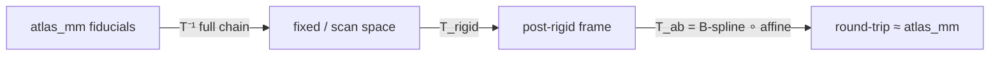

# Scanner distortion

Estimate geometric distortion introduced by the scanner from an elastix
registration of the SPIRIT atlas to a phantom scan. The method uses the packaged
fiducial landmarks (`atlas_mm` only) and the affine + B-spline stages of the
registration; rigid pose is excluded.

## Method

Elastix stores a forward transform \(T\) that maps **fixed (scan) → moving
(atlas)**:

\[
T = T_{\mathrm{bspline}} \circ T_{\mathrm{affine}} \circ T_{\mathrm{rigid}}
\]

(with an optional flip under the rigid stage when `--phantom-inverted` was used).

Given the 34 packaged fiducial centres \(p_m\) in atlas world millimetres:

1. **Map into scan space.** Apply an elastix-estimated inverse of the full chain
   so that \(p_f = T^{-1}(p_m)\). If registration is accurate, these points
   should land on the physical distortion markers in the scan. The analysis
   writes them as `fiducials_fixed_mm.txt` and paints
   `fiducials_fixed_mm.nii.gz` for visual QC.
2. **Remove rigid pose.** Apply the rigid stage alone:
   \(p_r = T_{\mathrm{rigid}}(p_f)\). These coordinates sit in the post-rigid
   intermediate frame — the input domain of affine∘B-spline.
3. **Apply affine + B-spline only.** Rewrite the affine parameter file with
   `NoInitialTransform` (rigid unlinked) and point the B-spline file at that
   copy, giving \(T_{ab} = T_{\mathrm{bspline}} \circ T_{\mathrm{affine}}\).
   Transformix of \(T_{ab}\) on \(p_r\) should recover \(p_m\) (logged as the
   non-rigid round-trip residual).
4. **Report the residual.** The displacement attributed to scanner geometric
   distortion is

\[
d = p_m - p_r
\]

with magnitude \(\|d\|\) and radius from the phantom isocentre
\(\|p_m\|\). Aggregate mean / max / RMS magnitudes are written to
`distortion_summary.csv`.

Under the assumption that elastix has split pose into the rigid stage and
shape change into affine + B-spline, \(d\) is the deformation induced by those
two stages between the pose-aligned frame and atlas space.



## What rigid excludes (and what it does not)

The rigid stage is an elastix `EulerTransform`: **rotation and translation
only**. That is intentional.

Elastix registers in **physical millimetres**, using each image’s spacing,
origin and direction. A finer atlas and a coarser scan of the same phantom
already share a common mm frame through their headers. Different voxel sizes or
matrix sizes are sampling differences, not a registration degree of freedom, and
do **not** need to be absorbed by Euler.

What *does* belong in the reported residual:

| Effect | Stage |
| --- | --- |
| Pose in the bore (rotate, translate; optional inverted-phantom flip) | Rigid — **excluded** |
| Apparent size change, anisotropic stretch, shear (e.g. gradient scaling) | Affine — **included** |
| Local non-linear warp | B-spline — **included** |

So voxel-count / resolution mismatch is handled by geometry metadata; true
geometric scale error is treated as scanner distortion. Wrong NIfTI spacing
would look like scale distortion and bias the result — check headers if
magnitudes are implausible.

## Coordinates

Only **`atlas_mm`** is required. It is the NIfTI world millimetre centre of each
sphere in the published SPIRIT atlas (origin at the phantom centre). Design-frame
millimetres, voxel indices, and CAD provenance in the root
`spirit_fiducials.json` dump are not used by this analysis.

## CLI

After a `register` run:

```bash
uv run spirit-phantom analyse distortion \
  path/to/registration_output \
  path/to/scanner_image.nii.gz
```

Or in one step:

```bash
uv run spirit-phantom register \
  path/to/scanner_image.nii.gz \
  --analyse distortion
```

Outputs default to `<registration_output>/distortion/`.

## Python API

```python
from pathlib import Path

from spirit_phantom.core.distortion import evaluate_scanner_distortion

result = evaluate_scanner_distortion(
    registration_directory=Path("registration_output"),
    fixed_image_path=Path("scanner_image.nii.gz"),
    output_directory=Path("registration_output/distortion"),
)
print(result.summary)
for point in result.points:
    print(point.fiducial_id, point.magnitude_mm, point.radius_from_isocentre_mm)
```

## Output files

| File | Use it to |
| --- | --- |
| `distortion_summary.csv` | Record mean / max / RMS displacement magnitudes and the non-rigid round-trip residual. |
| `distortion_per_point.csv` | Per-fiducial coordinates, displacement vector, magnitude and radius from isocentre. |
| `fiducials_fixed_mm.nii.gz` | Overlay on the scan to check that inverse-mapped landmarks sit on the markers. |
| `fiducials_atlas_mm.txt`, `fiducials_fixed_mm.txt`, `fiducials_rigid_aligned_mm.txt`, `fiducials_nonrigid_roundtrip_mm.txt` | Transformix-format point dumps for each stage. |
| `affine_bspline_only/` | Rewritten affine (no rigid) and B-spline head used for the non-rigid stage. |
| `distortion.log` | Diagnostics, including inverse and non-rigid round-trip residuals. |

## Open doubts

Decided: pose = Euler only; distortion = affine + B-spline (see
[above](#what-rigid-excludes-and-what-it-does-not)). Remaining assumptions to
revisit before treating the numbers as a formal specification:

1. **Registration accuracy.** The residual is only as trustworthy as the
   elastix fit. Misregistration, intensity artefacts, or an under-constrained
   B-spline can invent or hide deformation. Checkerboards and the fixed-space
   fiducial mask are required QC, not optional.
2. **Affine + B-spline together.** Linear gradient scaling / shear is often
   what MRI QA means by geometric distortion, but some protocols report only
   the non-linear (B-spline) part after a separate similarity or affine fit to
   the markers. This implementation reports both stages combined.
3. **Marker detection vs transform pull-back.** The method does not detect
   spheres in the scan. It trusts that \(T^{-1}(p_m)\) coincides with the true
   marker centres. An independent detection + correspondence pipeline would be
   a useful cross-check (and is closer to classic phantom QA).
4. **Inverted phantom.** When `--phantom-inverted` was used, the flip is
   chained under rigid and is excluded with it. Confirm that this matches the
   intended definition of "pose" for that acquisition.
5. **Sign convention.** Displacement is stored as \(p_m - p_r\) (atlas minus
   post-rigid). The opposite vector is equally valid as a field direction;
   magnitude and RMS are unaffected.
6. **Isocentre.** Radius is measured from the atlas origin (phantom centre),
   not from the scanner magnet isocentre unless those frames coincide after
   registration.
7. **Header spacing.** Magnitudes assume trustworthy NIfTI spacing on both
   images. A wrong voxel size in the header masquerades as geometric scale
   error.

See also [Interpreting outputs](interpreting-outputs.md#scanner-distortion).
